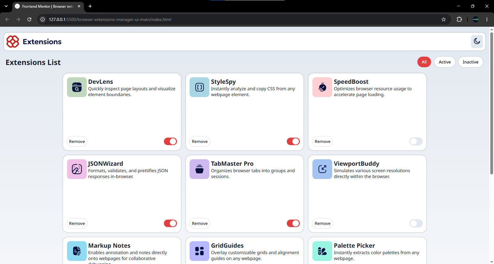

# Frontend Mentor - Browser extensions manager UI solution

This is a solution to the [Browser extensions manager UI challenge on Frontend Mentor](https://www.frontendmentor.io/challenges/browser-extension-manager-ui-yNZnOfsMAp).

## Table of contents

- [Overview](#overview)
  - [The challenge](#the-challenge)
  - [Screenshot](#screenshot)
  - [Links](#links)
- [My process](#my-process)
  - [Built with](#built-with)
  - [What I learned](#what-i-learned)
  - [Continued development](#continued-development)
  - [Useful resources](#useful-resources)
  - [AI Collaboration](#ai-collaboration)
- [Author](#author)
- [Acknowledgments](#acknowledgments)

## Overview

### The challenge

Users should be able to:

- Toggle extensions between active and inactive states
- Filter active and inactive extensions
- Remove extensions from the list
- Select their color theme
- View the optimal layout for the interface depending on their device's screen size
- See hover and focus states for all interactive elements on the page

### Screenshot



### Links

- Solution URL: [View my solution](MY_FRONTEND_MENTOR_SOLUTION_URL)
<<<<<<< HEAD
- Live Site URL: [View live site](https://naeemah-tech.github.io/Addon-Manager/)
=======
- Live Site URL: [View live site](MY_VERCEL_URL)
>>>>>>> 69d3539b5347ecca9bb861197ee3719eb46c70a4

## My process

### Built with

- Semantic HTML5
- CSS3
- CSS custom properties
- Flexbox
- Responsive design
- Vanilla JavaScript
- DOM manipulation
- Event listeners

### What I learned

This project helped me practice working with the DOM and handling user interactions with JavaScript.

I learned how to:

- Select elements using `querySelector()` and `querySelectorAll()`
- Add event listeners with `addEventListener()`
- Toggle CSS classes to change UI states
- Filter elements based on their current state
- Search through extension names and descriptions
- Remove elements from the page
- Create a light and dark theme using CSS classes
- Build a responsive layout using CSS

One part I particularly practiced was using JavaScript to control the active and inactive states of the extension toggles:

```js
toggles.forEach(function(toggle) {
    toggle.addEventListener("click", function() {
        if (toggle.classList.contains("active-btn")) {
            toggle.classList.remove("active-btn");
            toggle.classList.add("inactive-btn");
        } else {
            toggle.classList.remove("inactive-btn");
            toggle.classList.add("active-btn");
        }
    });
});